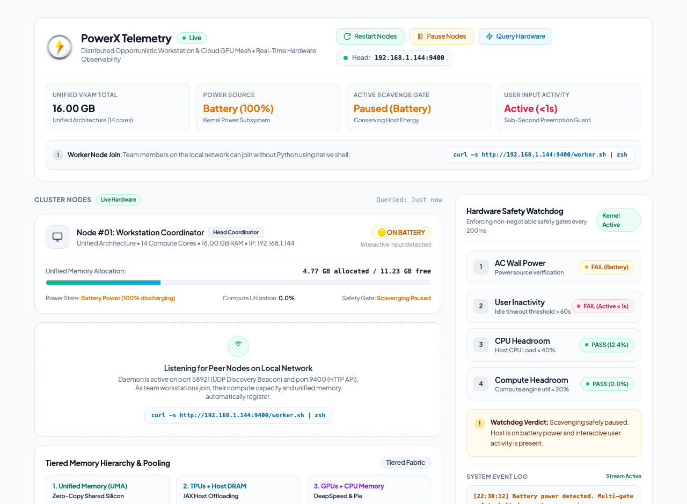

<div align="center">

  

  # PowerX

  ### Universal Compute Mesh & Real-Time Telemetry Fabric

  <p>
    Pool distributed accelerators, unified memory, and cloud GPUs into an elastic, zero-cost AI execution layer with kernel-level safety and real-time observability.
  </p>

  <p>
    <a href="https://biswajitbiswa.github.io/powerx/"></a>
    <a href="https://biswajitbiswa.github.io/powerx/docs/complete_docs.html"></a>
    <a href="tests/"></a>
    <a href="LICENSE"></a>
  </p>

  <p>
    <a href="https://biswajitbiswa.github.io/powerx/"><strong>Explore Live Dashboard →</strong></a> &nbsp;•&nbsp; 
    <a href="https://biswajitbiswa.github.io/powerx/docs/complete_docs.html"><strong>Read Architecture Documentation →</strong></a>
  </p>

</div>

---

## 🖥️ Live Telemetry Dashboard

PowerX includes a responsive, real-time telemetry dashboard providing complete visibility into cluster memory allocation, active worker nodes, kernel safety gates, and hardware utilization.

<div align="center">
  <a href="https://biswajitbiswa.github.io/powerx/">
    
  </a>
</div>

* **Interactive Live Dashboard**: [biswajitbiswa.github.io/powerx](https://biswajitbiswa.github.io/powerx/)
* **Complete Technical Documentation**: [biswajitbiswa.github.io/powerx/docs/complete_docs.html](https://biswajitbiswa.github.io/powerx/docs/complete_docs.html)
* **Local Node Dashboard**: `http://localhost:9400/dashboard`

---

## ⚡ What is PowerX?

Modern developer workstations feature massive unified memory pools (16GB–192GB RAM) capable of high-throughput AI workloads, yet cloud GPUs (H100/A100) are expensive to run continuously. Simultaneously, workstation compute sits idle during meetings, documentation reading, and overnight hours.

**PowerX** aggregates distributed local compute and cloud instances into an automated, zero-marginal-cost execution mesh:

1. **Zero-Configuration Network Discovery**: Nodes broadcast presence over UDP beacons (`port 58921`) and assemble into an elastic peer mesh instantly.
2. **Sub-Second Preemption Guard**: Samples hardware counters every 200ms. The instant interactive user input is detected, active jobs yield in **< 280ms** with automatic checkpointing.
3. **Local-First Tiered Dispatch**: Routes tasks to available local unified memory first ($0 cost), seamlessly bursting to Cloud GPUs (AWS/GCP/Lambda) only when local resources are busy or CUDA is required.
4. **Unified DCGM Observability**: Exposes standardized Prometheus metrics (`port 9400`) compatible with NVIDIA GPU Usage Monitor and Grafana dashboards out of the box.

---

## 🏗️ Architecture & Execution Fabric

PowerX connects heterogeneous compute nodes into a cohesive, tiered execution fabric:

| Tier | Infrastructure | Memory Architecture | Bandwidth | Primary Workload |
|---|---|---|---|---|
| **Tier 1 (Local)** | Distributed Workstations | Unified Silicon Architecture (UMA) | 200–800 GB/s | LLM fine-tuning, evaluation, embedding ($0 cost) |
| **Tier 2 (Cloud)** | NVIDIA H100 / A100 Clusters | High-Bandwidth Memory (HBM3) | 2.0–3.35 TB/s | Multi-node distributed pre-training & CUDA kernels |
| **Offload** | Host System Memory | JAX / DeepSpeed ZeRO-Infinity & Pie | PCIe Gen4/5 | Asynchronous KV-cache & optimizer tensor pooling |

```
               ┌────────────────────────────────────────────────────────┐
               │              PowerX Core Dispatcher                     │
               │   • Local-First Queue     • Hardware Preemption Guard  │
               └───────────────┬────────────────────────┬───────────────┘
                               │                        │
                 Local-First   │                        │  Cloud Spillover
                 ($0 Cost)     ▼                        ▼  (Peak Demand)
            ┌──────────────────────┐               ┌──────────────────────┐
            │   Local Compute Mesh │               │ Cloud GPU Cluster    │
            │   • 16–192GB Unified │               │ • NVIDIA H100 / A100 │
            │   • <280ms Preemption│               │ • Spot K8s Instances │
            └──────────┬───────────┘               └──────────┬───────────┘
                       │                                      │
                       └───────────────┬──────────────────────┘
                                       │
                                       ▼
                       ┌──────────────────────────────┐
                       │   Observability Standard     │
                       │   • Prometheus (:9400/metrics│
                       │   • NVIDIA DCGM Compatible   │
                       └──────────────────────────────┘
```

---

## 🛡️ Multi-Gate Safety Engine

PowerX guarantees that background compute never interrupts daily developer productivity through 4 continuous hardware gates:

| Gate | Check | Threshold | Action on Trigger |
|---|---|---|---|
| **1. Wall Power** | AC Power Subsystem | Host on AC Wall Power | Instant pause on battery disconnect (0% battery drain) |
| **2. User Activity** | Keyboard / Mouse Input | User Idle > 60s | Evicts workload within < 280ms on first keystroke |
| **3. CPU Headroom** | Host System Load | CPU Utilization < 40% | Defers compute during builds and local compilation |
| **4. Accelerator Util**| Engine Compute Load | Accelerator Util < 20% | Yields if user launches display-intensive apps |

---

## 🚀 Quickstart

### 1. Inspect Local Host Status
```bash
python3 -m hybrid_gpu_mesh.cli status
```

### 2. Launch Cluster Coordinator
Start the daemon on the coordinator machine:
```bash
python3 -m hybrid_gpu_mesh.cli daemon --worker --own
```
* Dashboard: `http://localhost:9400/dashboard`
* Prometheus Metrics: `http://localhost:9400/metrics`

### 3. Join Worker Nodes
On any worker machine on the network, join with a single command:
```bash
curl -s http://<HEAD-IP>:9400/worker.sh | zsh
```

### 4. Submit Compute Tasks
```bash
python3 -m hybrid_gpu_mesh.cli submit --vram 8 --bundle ./my_experiment --steps 500 \
    --label "experiment-1" -- "python3 train.py"
```

---

## 📊 Observability & Metrics

PowerX exposes native metrics matching the **NVIDIA DCGM Exporter** format:

* `DCGM_FI_DEV_GPU_UTIL`: Accelerator utilization percentage.
* `DCGM_FI_DEV_FB_USED` & `DCGM_FI_DEV_FB_FREE`: Memory allocation in bytes.
* `host_user_idle_seconds`: Real-time user inactivity timer.
* `host_is_on_ac_power`: Binary AC wall power indicator.
* `gpu_cluster_vram_total_bytes`: Aggregated memory pool across all cluster nodes.

---

## 🧪 Verification & Automated Tests

PowerX includes a complete suite of unit, integration, and end-to-end tests:
```bash
pytest -v
```
All 33 test suites validate kernel telemetry collectors, multi-gate idle safety, sub-second preemption, and peer discovery.

---

## 📄 License

Apache License 2.0. See [LICENSE](LICENSE) for details.
